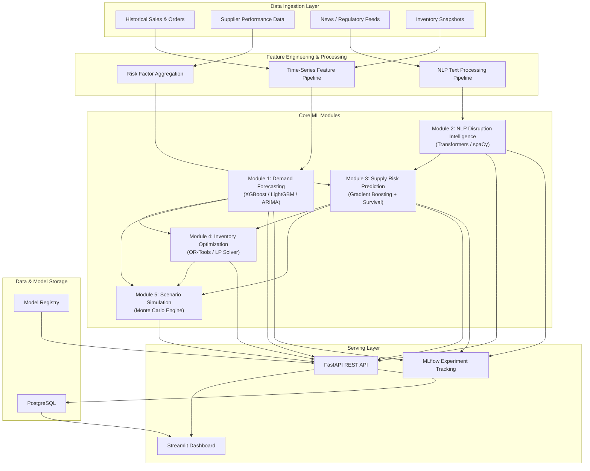

# SupplyPulse AI — Event-Aware Predictive Logistics and Supply Chain Resilience Platform


## Overview

**SupplyPulse AI** is an advanced, event-aware supply chain intelligence platform that fuses predictive analytics with real-time disruption sensing to deliver resilient logistics decision-making. The platform comprises five tightly integrated modules: **Demand Forecasting** (time-series and gradient-boosted models for SKU-level demand prediction), **NLP Disruption Intelligence** (transformer-based extraction of supply-chain-relevant events from news, regulatory filings, and social media), **Supply Risk Prediction** (multi-factor supplier reliability scoring and lead-time volatility estimation), **Inventory Optimization** (operations-research-driven safety stock, reorder point, and multi-echelon inventory policies), and **Scenario Simulation** (Monte Carlo and what-if engines that stress-test the supply network under configurable disruption scenarios). Together, these modules enable proactive, data-driven supply chain management that anticipates disruptions before they cascade.

## Architecture



## Tech Stack

| Category | Technologies |
|---|---|
| **Language** | Python 3.10 |
| **Data & Numeric** | Pandas, NumPy |
| **Machine Learning** | scikit-learn, XGBoost, LightGBM |
| **Statistical Modeling** | Statsmodels |
| **NLP** | Hugging Face Transformers, spaCy |
| **Optimization** | Google OR-Tools |
| **Database** | PostgreSQL, SQLAlchemy |
| **API** | FastAPI, Uvicorn, Pydantic |
| **Dashboard** | Streamlit |
| **Experiment Tracking** | MLflow |
| **Containerization** | Docker |

## Setup Instructions

### 1. Clone the Repository

```bash
git clone https://github.com/your-username/supplypulse-ai.git
cd supplypulse-ai
```

### 2. Create a Virtual Environment

```bash
python -m venv .venv

# Windows
.venv\Scripts\activate

# macOS / Linux
source .venv/bin/activate
```

### 3. Install Dependencies

```bash
# Production dependencies
pip install -r requirements.txt

# Development dependencies (includes testing and linting)
pip install -r requirements-dev.txt
```

### 4. Configure Environment Variables

```bash
cp .env.example .env
# Edit .env with your database credentials and settings
```

### 5. Set Up the Database

```bash
# Ensure PostgreSQL is running, then create the database
createdb supplypulse

# Run migrations / initialize schema
python -m src.infrastructure.database
```

### 6. Run the API Server

```bash
uvicorn src.api.main:app --host 0.0.0.0 --port 8000 --reload
```

### 7. Run the Dashboard

```bash
streamlit run src/dashboard/app.py
```

## Project Structure

```
SupplyPulse AI/
├── README.md
├── requirements.txt
├── requirements-dev.txt
├── setup.cfg
├── pyproject.toml
├── .env.example
├── .gitignore
├── config/
│   └── settings.yaml
├── src/
│   ├── __init__.py
│   ├── demand_forecasting/       # Module 1: Time-series & ML demand models
│   ├── disruption_intelligence/  # Module 2: NLP event extraction & classification
│   ├── supply_risk/              # Module 3: Supplier risk scoring & prediction
│   ├── inventory_optimization/   # Module 4: OR-based inventory policies
│   ├── scenario_simulation/      # Module 5: Monte Carlo & what-if analysis
│   ├── infrastructure/           # Database, config, shared utilities
│   ├── api/                      # FastAPI application & route handlers
│   └── dashboard/                # Streamlit interactive dashboard
├── tests/
│   ├── unit/
│   └── integration/
├── notebooks/
│   └── exploration/
└── docker/
    ├── Dockerfile
    └── docker-compose.yml
```

## Development Workflow

### Running Tests

```bash
pytest
pytest --cov=src --cov-report=html
```

### Code Formatting

```bash
black src/ tests/
```

### Linting

```bash
ruff check src/ tests/
```

### Type Checking

```bash
mypy src/
```

## License

This project is licensed under the **MIT License**. See the [LICENSE](LICENSE) file for details.

---

> **Note:** SupplyPulse AI is an advanced academic prototype developed by a single developer as a demonstration of event-aware, ML-driven supply chain resilience. It is designed for research and portfolio purposes and is not intended for production deployment without further hardening and validation.
